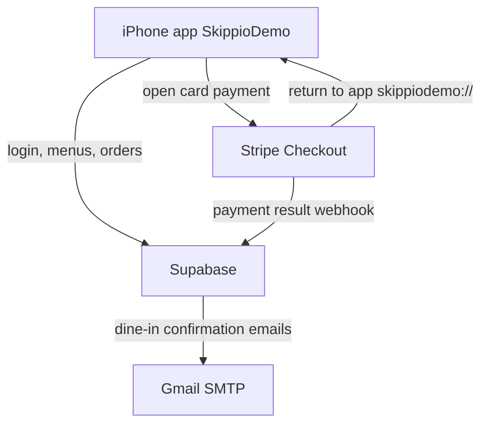
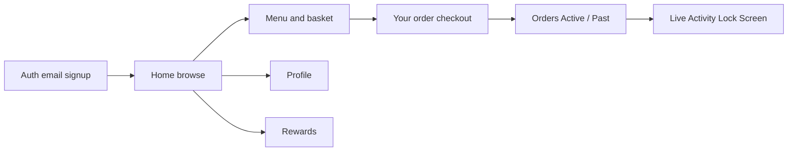
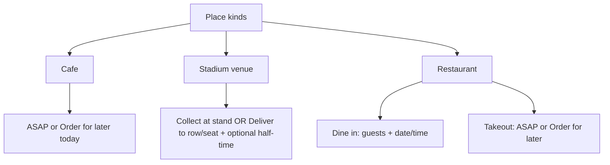
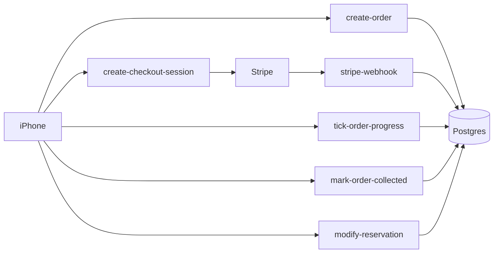
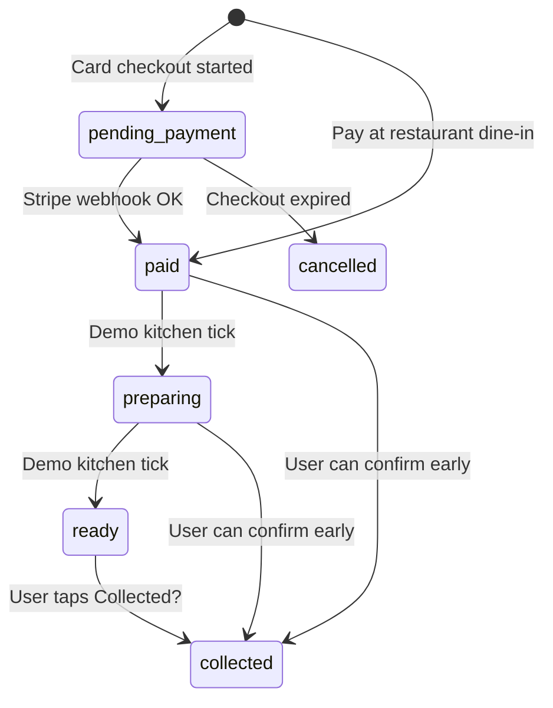

# Skippio Demo — System Architecture (Simple Guide)

This document explains how the Skippio demo app is built, in plain language.

**What the product does:** fans browse cafés, stadiums, and restaurants, put food in a basket, pay (or reserve a table), then track the order.

---

## 1. Big picture

There are three main pieces:

1. **iPhone app** — what the user taps (SwiftUI).
2. **Supabase** — database, login, and small server programs (“Edge Functions”).
3. **Stripe** — takes card payments safely (we never see the card number).



**Rule of thumb:** the phone shows the UI; **prices and payment status are decided on the server**, not trusted from the phone alone.

---

## 2. What’s inside the iPhone app



| Screen | Job |
|--------|-----|
| **Auth** | Sign up / log in with email + password. New accounts confirm with a **6-digit code** emailed via Gmail. |
| **Home** | Lists **Cafés**, **Venues** (stadiums), **Restaurants**. Can filter Open now, favourites, map. |
| **Menu** | Items + options. Bottom bar: **Your order**. |
| **Your order (cart)** | Review lines, promo, how to fulfill, then Pay / Confirm. |
| **Orders** | **Active** and **Past**. Collect / modify reservation. |
| **Live Activity** | Lock Screen / Dynamic Island for collection-style orders (not dine-in). |
| **Profile / Rewards** | Account and points UI (demo). |

Baskets are **one per place**, saved on the phone per signed-in user (`CartStore`).

---

## 3. Places and how ordering differs



| Kind | Fulfillment | Payment |
|------|-------------|---------|
| **Café** | Collection: ASAP or later today (hour + 5‑min wheels) | Stripe |
| **Venue** | **Collect** or **Deliver** (row + seat). Optional half-time. | Stripe |
| **Restaurant dine-in** | Table reservation (guests, date, time). No Live Activity. | **Pay now** (Stripe) or **Pay at restaurant** |
| **Restaurant takeout** | Same time slots as cafés | Stripe |

---

## 4. Backend (Supabase)

### Database (Postgres)

Main tables (simplified):

| Table | Holds |
|-------|--------|
| `venues` | Cafés / stadiums / restaurants |
| `collection_points` | Stands / pickup points |
| `menu_categories` / `menu_items` / options | Menus |
| `orders` | Status, money, fulfillment, seats, reservation |
| `order_items` | Lines on an order |
| `order_status_events` | History notes |
| `profiles` / favourites / promo codes | User extras |

**RLS (Row Level Security):** users can only read their own orders. Creating an order goes through `create-order` (the service role). Menus are public-readable. Pay-at-restaurant reservations are capped at 5 per account per day, and reservation edits at 5 per account per hour.

**Indexes:** primary keys and unique fields (e.g. `idempotency_key`). No extra custom indexes yet (fine for demo size).

### Auth

- Email + password.
- Confirmation OTP length set to **6 digits**.
- Auth emails go through **Gmail SMTP**.

### Storage

- Bucket `catalog` for menu/cover photos (often Wikimedia Commons–licensed).

### Edge Functions (server code)

| Function | What it does |
|----------|----------------|
| `create-order` | Recalculates price, creates order, promo + 7.5% fee. Dine-in **pay at venue** → email now. |
| `create-checkout-session` | Starts Stripe Checkout for unpaid orders. |
| `stripe-webhook` | **Only** trusted path that marks card orders **paid** (signature + amount check). Dine-in **pay now** → email after paid. |
| `checkout-return` | Redirects Stripe back into the app (`skippiodemo://`). |
| `tick-order-progress` | Demo kitchen clock: paid → preparing → ready over ~5–10 minutes. |
| `mark-order-collected` | Active → collected (Past); ends Live Activity on the phone. |
| `modify-reservation` | Change dine-in guests/time; sends update email. |
| `delete-account` | Deletes the signed-in user. |



---

## 5. Money flow (card pay)

```mermaid
sequenceDiagram
  participant User
  participant App
  participant CreateOrder as create-order
  participant Checkout as create-checkout-session
  participant Stripe
  participant Webhook as stripe-webhook
  participant DB as Postgres

  User->>App: Tap Pay
  App->>CreateOrder: Basket + idempotency key
  CreateOrder->>DB: Insert order pending_payment
  CreateOrder-->>App: order id + totals
  App->>Checkout: order id
  Checkout-->>App: Stripe URL
  App->>Stripe: Open Checkout sheet
  User->>Stripe: Pay
  Stripe->>Webhook: Signed event
  Webhook->>DB: Mark paid if amount matches
  Stripe-->>App: Return skippiodemo://
  App->>DB: Poll / refresh Orders
```



Important:

- Creating an order does **not** mean paid (except dine-in **pay at restaurant**, which starts as paid).
- The app never marks an order paid by itself after Stripe.

---

## 6. Order statuses (what the fan sees)



In the **Orders** tab:

- **Active** shows Preparing / Ready (and paid treated as Preparing). Unpaid drafts are **hidden**.
- **Past** shows Collected / Cancelled.
- **Collected?** on Active (bottom right) → confirm → Live Activity dismissed.
- **Modify reservation** only on active **dine-in** orders.

---

## 7. Live Activities vs dine-in email

| Situation | Notification |
|-----------|----------------|
| Café / stadium / restaurant **takeout** (after pay) | Live Activity on Lock Screen (status text, **no countdown timer**). Tap → Active Orders. |
| Restaurant **dine-in** | **Email** confirmation. No Live Activity. |
| Dine-in **Pay at restaurant** | Email when reservation is confirmed. |
| Dine-in **Pay now** | Email **after** Stripe payment succeeds. |
| User modifies reservation | Update email sent. |

---

## 8. Catalog and how data gets in

Source of truth for places/menus:

1. Edit `supabase/catalog/catalog.json`
2. Run `scripts/build_catalog.py` → SQL migration + Storage uploads
3. `supabase db push`

The app then reads venues/menus from Postgres + image URLs from Storage.

---

## 9. Secrets (what lives where)

| Where | What |
|-------|------|
| **iPhone** | Supabase project URL + **anon** key only |
| **Edge Functions / `.env`** | Service role, Stripe secret + webhook secret, Gmail address + app password |
| **Never in git** | Real `.env` values |

URL scheme for returning from Stripe / Live Activity deep link: **`skippiodemo://`**.

---

## 10. One-sentence summary

**The iPhone is a friendly client; Supabase stores data and runs trusted order/payment logic; Stripe handles cards; Gmail sends dine-in emails; Live Activities track collection-style orders without timers.**

---

## Folder map

```
skippio-product/
  ios/SkippioFan/          # SwiftUI app + widgets
  supabase/migrations/     # Database schema
  supabase/functions/      # Edge Functions
  supabase/catalog/        # Menu/venue source JSON
  scripts/                 # Catalog build, auth email config, e2e
  ARCHITECTURE.md          # This file
  README.md                # Setup commands
```
